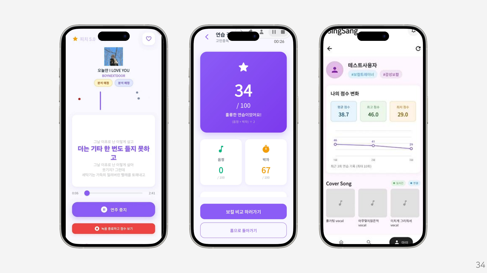
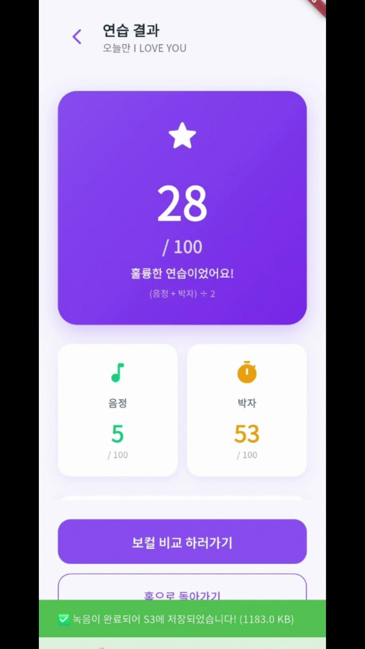
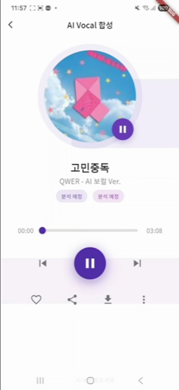
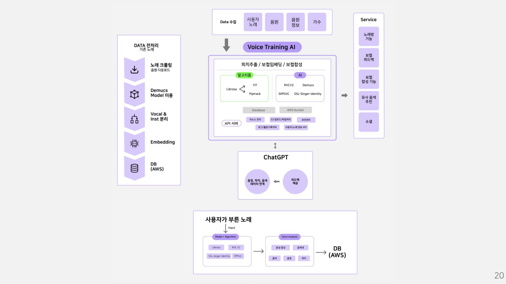
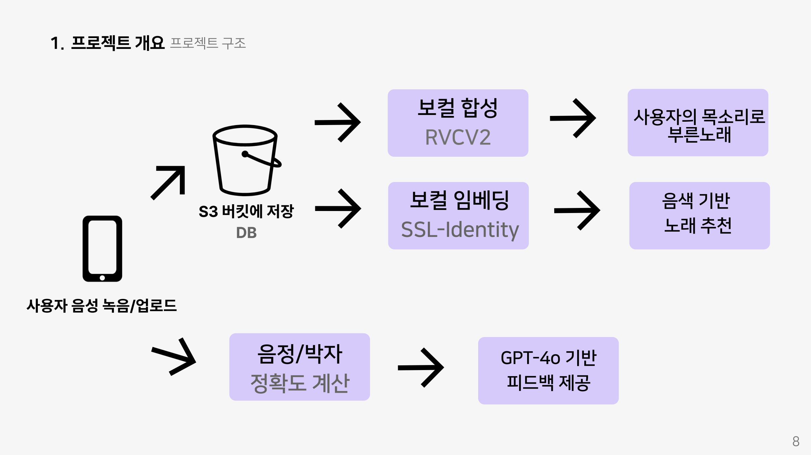
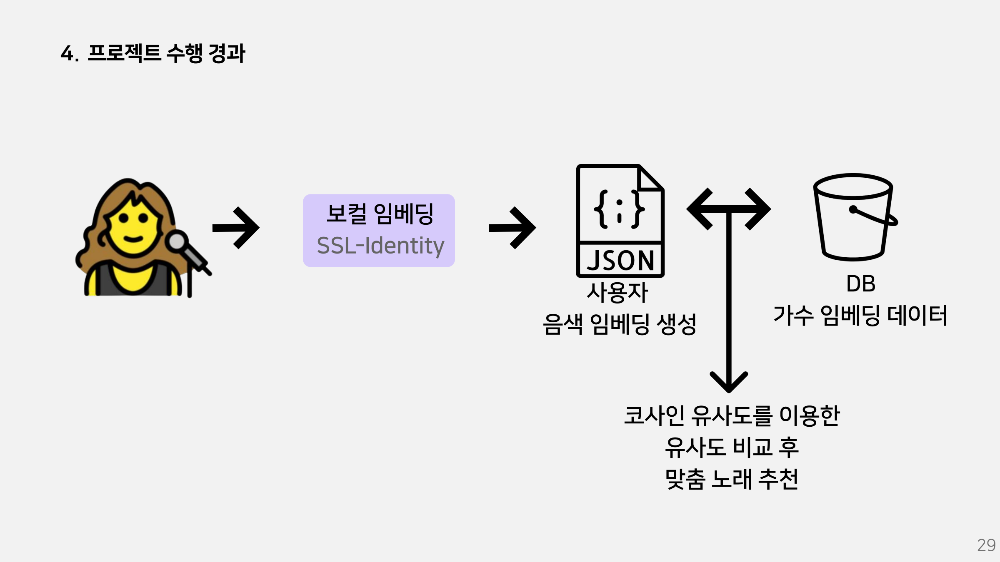
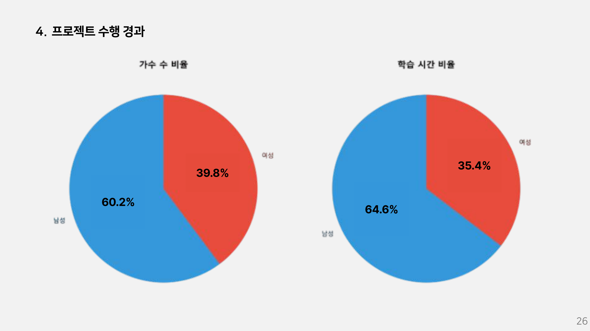
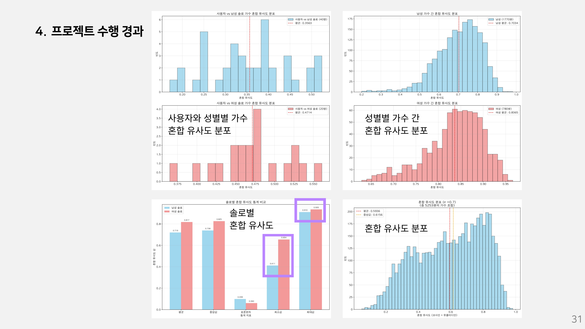

# SingSang 🎤

### 내 목소리를 이해하고, 어울리는 노래를 찾아 연습하는 AI 보컬 트레이닝 서비스

SingSang은 사용자의 목소리를 분석해 **음색이 비슷한 가수의 노래를 추천**하고, **내 목소리로 변환한 보컬**을 들어보며, **음정·박자 분석 결과로 연습을 돌아볼 수 있는** 모바일 프로젝트입니다.

Flutter 앱과 FastAPI 기반 API, 음성 처리 모델을 연결해 녹음부터 분석·추천·보컬 합성까지 이어지는 개인화된 연습 경험을 구성했습니다.

[최종 발표자료](docs/SingSang_최종발표.pdf) · [노래 연습·점수 그래프 시연](docs/media/scoring-demo.mp4) · [AI 보컬 합성 시연](docs/media/voice-conversion.mp4)

> 최종 발표자료와 시연 영상을 바탕으로 서비스 기능과 시스템 설계를 정리했습니다.

## 프로젝트 배경

노래를 연습할 때는 점수뿐 아니라 자신의 목소리에 대한 이해도 필요합니다. SingSang은 다음 세 가지 질문에서 출발했습니다.

- **내 목소리에 어울리는 노래는 무엇일까?** → 음색 임베딩을 활용한 곡 추천
- **내 목소리로 이 노래를 부르면 어떻게 들릴까?** → 개인 음성 모델을 활용한 보컬 합성
- **어떤 부분을 더 연습해야 할까?** → 음정·박자 분석과 자연어 피드백

## 주요 기능

| 기능 | 내용 | 사용 기술 |
| --- | --- | --- |
| 음색 기반 노래 추천 | 사용자와 가수의 음색 임베딩을 비교해 유사한 가수의 곡 추천 | SSL-Singer-Identity 계열 보컬 임베딩, 코사인 유사도 |
| AI 보컬 합성 | 사용자 음성으로 개인 모델을 학습하고, 선택한 곡의 보컬을 사용자 음색으로 변환 | RVC V2 |
| 노래 연습과 점수 확인 | 노래 연습 후 음정·박자 점수와 종합 결과 확인 | 피치·박자 분석, Flutter UI |
| 개인화 피드백 | 음정·박자 분석 결과를 바탕으로 자연어 피드백 제공 | GPT-4o |
| 연습 이력 확인 | 이전 연습 점수와 변화 그래프 확인 | 연습 기록 저장·시각화 |

### 시연 영상

| 노래 연습·점수 그래프 | AI 보컬 합성 |
| --- | --- |
|  |  |
| [영상 보기 · 약 41초](docs/media/scoring-demo.mp4) | [영상 보기 · 약 14초](docs/media/voice-conversion.mp4) |
| 노래 연습 → 음정·박자 결과 → 보컬 비교 화면 → 점수 변화 그래프 | 사용자 음색으로 변환한 보컬의 재생 화면 |

※ 영상 링크는 원본 MP4 파일로 연결됩니다. GitHub 화면에서 미리보기가 제공되지 않으면 파일을 다운로드해 재생할 수 있습니다.

## 시스템 구조

사용자가 앱에서 녹음하거나 업로드한 음성을 저장한 뒤, 목적에 따라 세 가지 처리 흐름으로 연결합니다.

### 전체 시스템 아키텍처

음원 수집·전처리, API 서버, 음성 분석·합성 모델, 저장소를 연결한 전체 구조입니다.

### 사용자 음성의 처리 흐름

1. **보컬 합성:** 사용자 음성 → RVC V2 모델 학습·변환 → 사용자 음색의 보컬
2. **음색 기반 추천:** 사용자 음성 → 보컬 임베딩 → 가수 임베딩과 유사도 비교 → 곡 추천
3. **연습 피드백:** 사용자 노래 → 음정·박자 정확도 계산 → GPT-4o 기반 자연어 피드백

API 계층은 사용자·노래 정보, 음성 파일 업로드, 모델 학습·추론 요청, 연습 결과를 연결하도록 설계했습니다. 파일 저장소와 데이터베이스를 통해 음원 파일 및 관련 정보를 관리하는 구조입니다.

### 기술 스택

| 영역 | 기술 | 역할 |
| --- | --- | --- |
| 모바일 | Flutter, TarsosDSP | 앱 UI, 음성 입력·분석 |
| API | Python, FastAPI | 사용자·음원·분석·모델 처리 흐름 연결 |
| 오디오 처리 | Demucs, Spleeter, librosa | 보컬·반주 분리 및 오디오 분석 |
| 보컬 변환 | RVC V2 | 개인 음성 모델 학습과 보컬 변환 |
| 음색 추천 | SSL-Singer-Identity 계열 임베딩 | 사용자·가수 음색의 벡터 표현 및 비교 |
| 피드백 | GPT-4o | 분석 결과의 자연어 피드백 |
| 인프라·저장 | AWS S3, Railway, RunPod | 음성 파일 저장, 서버·GPU 실행 환경 |
| 협업·설계 | GitHub, Notion, Figma | 버전 관리, 작업 관리, 화면 설계 |

## 음색 추천을 위한 데이터 구성

음색 추천은 사용자 임베딩과 비교할 가수 데이터가 필요합니다. 음원 수집 이후 **보컬·반주 분리 → 보컬 임베딩 생성 → 저장 → 유사도 비교**로 이어지는 데이터 처리 흐름을 구성했습니다.

데이터 구성에서는 총량과 함께 **성별별 가수 수와 시간 분포**를 확인했습니다. 가수 수만 비교하면 가수별로 확보한 음성 분량의 차이를 놓칠 수 있어 두 지표를 함께 살펴봤습니다.

| 구분 | 남성 | 여성 | 합계 |
| --- | ---: | ---: | ---: |
| 가수 수 | 62명 | 41명 | 103명 |
| 가수 수 비율 | 60.2% | 39.8% | 100% |

발표자료에는 가수 수뿐 아니라 성별별 시간 분포도 함께 정리했습니다. 이후 사용자·가수 간 유사도와 성별별 가수 간 유사도 분포를 비교해 추천에 사용하는 음색 표현을 살펴봤습니다.

유사도 분포 분석 보기

사용자와 가수의 유사도, 성별별 가수 간 유사도, 전체 혼합 유사도 분포를 비교한 발표자료입니다. 유사도 분포를 보여주는 탐색 분석이며 추천 정확도 평가를 의미하지는 않습니다.

## RVC V2 보컬 합성 비교

사용자 음성 모델을 활용해 보컬을 변환하고 재생하는 흐름을 시연했습니다. 최종 발표에서는 **‘3분 학습’, ‘30분 학습’, ‘1시간 학습’**으로 표시된 세 조건의 오디오 샘플을 비교했습니다.

모델 설정에 따른 결과를 직접 들어보기 위한 비교 실험으로, 조건명은 발표자료의 표기를 따랐습니다.

[AI 보컬 합성 시연 영상 보기](docs/media/voice-conversion.mp4)

## 팀 구성과 역할

4명이 함께 진행했으며, 발표 일정표에는 6월 23일부터 7월 30일까지 기획·설계·개발·테스트 일정이 정리되어 있습니다.

| 팀원 | 담당 역할 |
| --- | --- |
| **조현석 · 팀장** | 전체 시스템·API 설계, 음색 추천용 데이터 수집·가공 및 데이터 분포 점검, 사용자 인증·음성 녹음, RVC V2 훈련 설정, 데이터베이스·저장 솔루션 구성 |
| 이윤지 | 백엔드 인프라, 음색 기반 추천 알고리즘, 음역대·음색 추출 알고리즘, GPT-4o 기반 자연어 피드백 |
| 이동욱 | 퍼펙트 스코어 알고리즘, 프론트엔드 UI, 피치·박자 정밀 감지 알고리즘 |
| 김채민 | 퍼펙트 스코어 알고리즘, 프론트엔드 UI, 피치·박자 정밀 감지 알고리즘 |

역할은 최종 발표자료를 기준으로 정리했으며, 조현석의 시스템·API 설계와 데이터 작업은 본인 설명을 함께 반영했습니다. 추천 알고리즘 개발과 추천용 데이터 구축의 기여를 구분했습니다.

## 회고와 개선 과제

- **협업:** 각자 맡은 기능을 책임지고 연결했으며, 의사소통 과정에서 발생한 혼선과 일정 손실을 회고했습니다.
- **개발 환경:** 초기 환경 구축에 시간이 소요되어, 공통 실행 환경을 초기에 정리할 필요성을 확인했습니다.
- **모바일 경험:** 음성 처리 기능을 모바일에서 원활하게 사용할 수 있도록 최적화가 필요했습니다.
- **시간 관리:** 데이터 준비, 모델 설정, 기능 통합에 필요한 시간을 함께 고려하는 일정 관리의 중요성을 배웠습니다.

## 프로젝트 자료

- [최종 발표자료 · PDF 38페이지](docs/SingSang_최종발표.pdf)
- [노래 연습·점수 그래프 시연](docs/media/scoring-demo.mp4)
- [AI 보컬 합성 시연](docs/media/voice-conversion.mp4)
